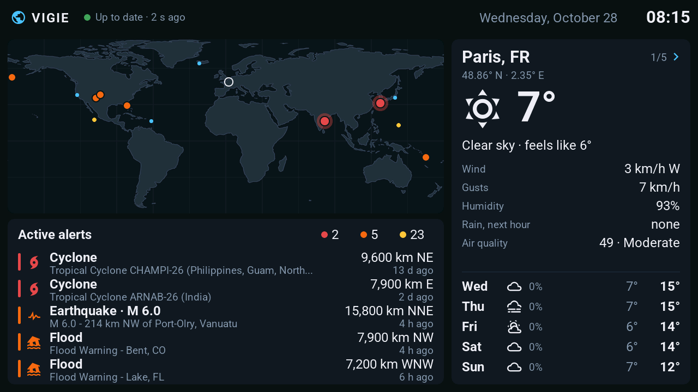
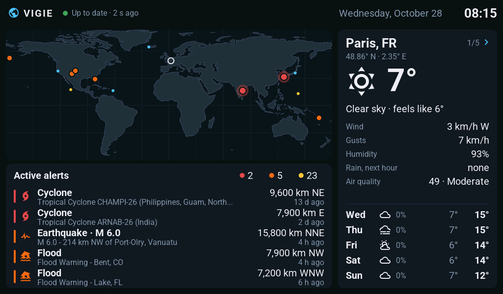
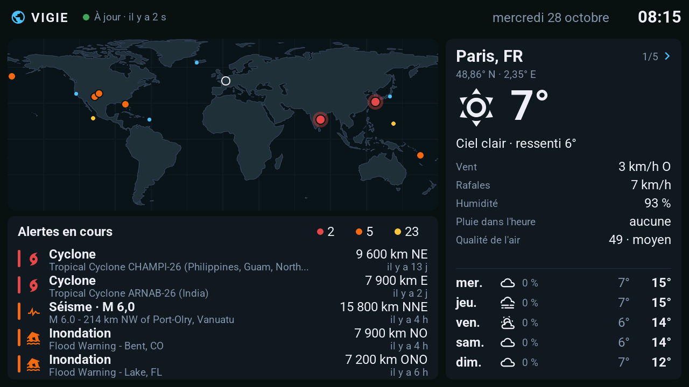

# Vigie display

World hazards and local weather on an ESP32-P4 touch screen, without Home Assistant.

**[Project page](https://axellum.github.io/vigie-display/)** ·
**[Installation](docs/installation.md)** · [Hardware](docs/hardware.md) ·
[vigie-api](https://github.com/Axellum/vigie-api) · [Vigie on the web](https://vigie.auxfilsdesidees.fr)



Vigie is a personal, non-commercial project in two parts:

- **vigie-api** — a Python service that gathers earthquakes, tsunamis, volcanoes, cyclones, floods,
  wildfires, space weather and weather forecasts from public sources, merges them and serves a
  compact text frame.
- **vigie-display** (this repository) — ESPHome + LVGL firmware that fetches that frame over the
  network every minute and shows it.

Vigie does not replace official warnings: follow the instructions of your authorities.

## What the screen shows

| Area | Content |
| :--- | :--- |
| Status bar | Link to the API (up to date, waiting, unreachable — with the age of the data), date and time of the active zone |
| World map | Active hazards (dot colour = severity: red, orange, yellow, green) and the watched zones |
| Alert list | The five most severe hazards: type, magnitude when defined, source title, distance and direction from the active zone, age |
| Weather panel | Active zone: current weather, wind, gusts, humidity, rain in the next hour, air quality, waves (coastal zones), five-day forecast. Touch it to show the next zone |

Texts are in English, or in French with `-s vigie_language fr`. Values the API does not know are
left out, never invented.

## Hardware

| Board | Screen | `vigie_board` | Status |
| :--- | :--- | :--- | :--- |
| Waveshare ESP32-P4-WIFI6-Touch-LCD-7B | 7", 1024×600 | `waveshare-7b` (default) | ✅ Tested on the board |
| M5Stack Tab5 (ST7123, ST7121, ILI9881C) | 5", 1280×720 | `tab5` | 🧪 Compiled and rendered; board settings from the Tab5 project, Vigie not run on a Tab5 yet |

| Waveshare 7B, 1024×600 | M5Stack Tab5, 1280×720 |
| :---: | :---: |
|  |  |

Screenshots rendered from the firmware itself by CI (`vigie-render.yaml`), with a live frame of
the public API. Notes on the boards: [docs/hardware.md](docs/hardware.md).

## Install

Step by step, from a bare board: **[docs/installation.md](docs/installation.md)**. In short, with
ESPHome 2026.9.1 or newer and an RSA 3072 signing key (`openssl genrsa -out vigie_signing_key.pem 3072`;
`*.pem` is ignored by git, keep it safe: every later update must be signed with the same key):

```bash
esphome -s vigie_board tab5 -s vigie_api_url https://vigie.auxfilsdesidees.fr -s vigie_signing_key vigie_signing_key.pem run vigie.yaml
```

| Substitution | Default | Meaning |
| :--- | :--- | :--- |
| `vigie_board` | `waveshare-7b` | Board: `waveshare-7b` or `tab5` (`firmware/packages/board-<name>.yaml`) |
| `vigie_api_url` | `http://vigie-api.local:8080` | Base URL of vigie-api: the public one, `https://vigie.auxfilsdesidees.fr`, or your own |
| `vigie_api_interval` | `60s` | Refresh period |
| `vigie_language` | `en` | Screen language: `en` or `fr` |
| `vigie_signing_key` | `vigie_signing_key.pem` | Firmware signing key |
| `vigie_version` | `0.1.0-dev` | Firmware version (the release tag) |
| `board_tab5_panel`, `board_tab5_touch`, `board_tab5_touch_interval` | ST7123 | Tab5 revision ([hardware](docs/hardware.md#revisions)) |
| `board_rotation` | `0` (7B), `270` (Tab5) | `180` for a 7B mounted the other way up |

Wi-Fi credentials are not in the configuration: give them after the first flash with Improv
(USB, e.g. [ESPHome Web](https://web.esphome.io)) or through the `Vigie setup` access point.

## Repository layout

| Path | Content |
| :--- | :--- |
| `vigie.yaml` | ESPHome entry point |
| `vigie-render.yaml` | The same screen built for ESPHome's `host` platform: screenshots without a board |
| `firmware/core/` | Pure C++ (no ESPHome, no LVGL), tested on a PC: world state, frame decoding, texts and formatting, API client logic |
| `firmware/display/` | LVGL screen and board helpers (panel power, C6 Wi-Fi link) |
| `firmware/packages/` | ESPHome packages: boards (`board-*`), their screen geometry (`layout-*`), screen, API client |
| `firmware/fonts/`, `firmware/images/` | Fonts (licences in `LICENSES.md`) and the world maps, one per map size |
| `tools/` | C++ tests, world map generator and its data, render converter |
| `tests/` | pytest guards and the API frame fixture |
| `docs/` | Installation, hardware, architecture, frame contract, development, decisions |
| `site/` | The project page (GitHub Pages) |

## Licences and data

Code: MIT ([LICENSE](LICENSE)). Fonts: see [firmware/fonts/LICENSES.md](firmware/fonts/LICENSES.md).
Map: Natural Earth (public domain, [tools/data/SOURCES.md](tools/data/SOURCES.md)). Hazard and
weather data come from the sources listed by [vigie-api](https://github.com/Axellum/vigie-api#data-sources),
under their own terms.
