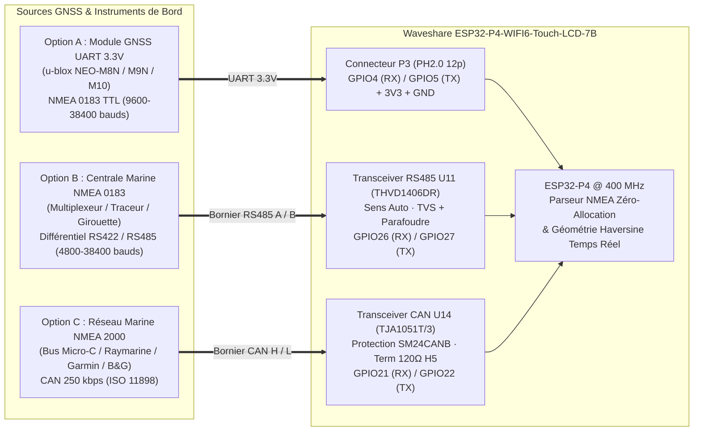

# Audit d'Ingénierie — Intégration GPS Externe & Mode Marine / Expédition sur Waveshare 7B

`maj: 2026-10-18` · Étude matérielle, protocole NMEA 0183 / NMEA 2000 et architecture temps réel pour **Vigie Mondiale 7B** (`alerte_mondiale_7b`).

---

## 1. Objectif Opérationnel : Du Terminal Fixe au Centre de Situation Mobile (Mer & Expédition)

Dans sa configuration de base, **Vigie Mondiale 7B** surveille jusqu'à 10 zones géographiques prédéfinies (villes, ports, sites industriels). Cependant, les cas d'usage les plus critiques en matière de risques naturels et météorologiques concernent les **unités mobiles** :
- **Navigation maritime & plaisance hauturière** : Voiliers de grande croisière, navires de pêche, vedettes de sauvetage (SNSM / garde-côtes), navires marchands.
- **Expéditions scientifiques & Sécurité Civile** : Véhicules PC mobile de crise, missions volcanologiques ou sismologiques sur le terrain, convois humanitaires.

L'analyse du schéma électronique de la **Waveshare ESP32-P4-WIFI6-Touch-LCD-7B** révèle que cette carte dispose nativement de **trois interfaces matérielles idéales** (UART 3.3V sur connecteur, RS485 isolé/protégé à direction automatique, et bus CAN haute vitesse) permettant de lui adjoindre un **récepteur GNSS externe** ou de la relier directement à la **centrale de navigation d'un navire**.

---

## 2. Les 3 Options Matérielles de Raccordement GPS / Navigation sur la Waveshare 7B



### Option A — Module GNSS UART 3.3V Autonome (u-blox NEO-M8N / NEO-M9N / MAX-M10S)
C'est la solution la plus simple, compacte et économique (~12 € à 25 €) pour rendre la tablette 100 % autonome en géolocalisation, dans un véhicule ou sur une table à cartes :
- **Connecteur recommandé** : Connecteur **`P3`** (PH2.0 12 broches) ou **`P1`** (PH2.0 12 broches).
- **Câblage sur `P3` (Configuration par défaut de `vigie-gps-nmea.yaml`)** :
  - `3V3` (`P3`) $\rightarrow$ `VCC` du module GNSS (consommation typique : ~25 mA sur u-blox M8N/M9N, ~8 mA sur M10).
  - `GND` (`P3`) $\rightarrow$ `GND` du module GNSS.
  - **`GPIO4` (RX du P4)** $\leftarrow$ `TX` du module GNSS (réception des trames NMEA `$GNRMC` et `$GNGGA`).
  - **`GPIO5` (TX du P4)** $\rightarrow$ `RX` du module GNSS (optionnel : envoi de commandes UBX pour fixer le rafraîchissement à 1 Hz ou 5 Hz).
- **Variante sur `P1`** : Broches libres **`GPIO46` (RX)** et **`GPIO47` (TX)** (+ `3V3` et `GND`).
- **Avantages** : Aucune électronique externe requise, acquisition multi-constellations (GPS + Galileo + GLONASS + BeiDou), précision horizontale $< 1,5\text{ m}$ CEP, PPS disponible sur une broche libre (`GPIO2` ou `GPIO3`) si une synchronisation sub-milliseconde est souhaitée.

### Option B — Centrale de Navigation Marine NMEA 0183 sur le Bus RS485 Intégré (`U11 THVD1406DR`)
C'est l'atout maître de la Waveshare 7B pour le monde maritime. Presque tous les instruments de bord (traceurs Garmin/Raymarine/Furuno, transpondeurs AIS, centrales inertielles, multiplexeurs NMEA) publient un flux **NMEA 0183 (IEC 61162-1)** sur une paire différentielle RS422/RS485 :
- **Matériel déjà embarqué sur la 7B** :
  - Émetteur-récepteur **`U11` (`THVD1406DR` ou `MAX13487`)** à **direction automatique (Auto-Direction)** : aucun GPIO `DE`/`RE` n'est nécessaire, la puce bascule seule en réception par défaut !
  - **Protection industrielle marine** : Le schéma intègre des fusibles réarmables, des diodes TVS d'écrêtage de transitoires et un éclateur parafoudre sur les lignes `RS485_A` et `RS485_B`.
  - **Terminaison 120 Ω** : Activable par simple pose d'un cavalier sur **`H6`**.
- **Brochage ESP32-P4 (Attention au piège de nomenclature du wiki Waveshare)** :
  - Sur le schéma électronique, le signal `485_RXD` désigne l'entrée `DI` de la puce RS485 (donc ce qu'elle reçoit du P4 sur **`GPIO27`**), et `485_TXD` désigne la sortie `RO` du récepteur RS485 (donc ce qu'elle envoie vers le RX du P4 sur **`GPIO26`**).
  - **Dans ESPHome (`uart:`)**, il faut donc configurer :
    - **`rx_pin: GPIO26`** (sortie `RO` du `THVD1406DR` $\rightarrow$ entrée RX de l'ESP32-P4).
    - **`tx_pin: GPIO27`** (sortie TX de l'ESP32-P4 $\rightarrow$ entrée `DI` du `THVD1406DR`).
  - **Débits standards** : `4800` bauds (NMEA 0183 historique) ou `38400` bauds (NMEA 0183 High-Speed / AIS).
- **Valeur ajoutée** : En deux fils (`A+` / `B-`) sur le bornier à vis de la 7B, le terminal récupère non seulement le **GPS de tête de mât du bateau** (`$GNGGA`, `$GNRMC`), mais peut aussi lire le cap compas (`$HCHDG`), la profondeur sondeur (`$SDDBT`) et le vent réel (`$IIMWV`) !

### Option C — Réseau Marine NMEA 2000 (CAN Bus) sur l'Émetteur-Récepteur CAN Intégré (`U14 TJA1051T/3`)
Pour les navires modernes équipés d'un backbone **NMEA 2000 (DeviceNet / Micro-C)** :
- **Matériel déjà embarqué sur la 7B** :
  - Transceiver CAN haute vitesse **`U14` (`TJA1051T/3`)** alimenté en 5 V avec E/S logiques 3,3 V compatibles P4.
  - Protection ESD/surtension dédiée **`SM24CANB`** et cavalier de terminaison 120 Ω sur **`H5`**.
  - Relié au contrôleur TWAI (CAN) matériel de l'ESP32-P4 sur **`rx_pin: GPIO21`** et **`tx_pin: GPIO22`**.
- **Paramètres réseau NMEA 2000** : Débit fixe **250 kbps**, identifiants CAN étendus 29 bits (ISO 11783).
- **Principaux PGNs exploitables** :
  - `PGN 129025` (*Position, Rapid Update* — 10 Hz) : Latitude et Longitude en $10^{-7}\text{ deg}$ (entiers 32 bits signés).
  - `PGN 129026` (*COG & SOG, Rapid Update* — 4 Hz) : Cap sur le fond (`COG`) en $10^{-4}\text{ rad}$ et vitesse sur le fond (`SOG`) en $10^{-2}\text{ m/s}$.
  - `PGN 129029` (*GNSS Position Data*) : Altitude, nombre de satellites, HDOP, date/heure UTC.
  - `PGN 130306` (*Wind Data*) & `PGN 130311` (*Environmental Parameters* : température de l'eau, pression atmosphérique).
- *Note d'alimentation* : Le bus NMEA 2000 transporte du `12 V DC` (`NET-S` / `NET-C`). La 7B ne doit relier que `CAN_H`, `CAN_L` et `GND` sur son bornier CAN, ou utiliser un abaisseur `12 V → 5 V USB-C` externe pour s'alimenter sur la batterie de servitude du bord.

---

## 3. Impact Fonctionnel Majeur : La « Zone 0 » Dynamique & Le Radar Relatif Temps Réel

L'ajout d'une source GPS transforme profondément l'expérience utilisateur et la pertinence opérationnelle de **Vigie Mondiale 7B** :

### 3.1. Zone 0 Dynamique : « Position Bateau / GPS Live »
Au lieu d'avoir uniquement des villes statiques, l'emplacement `zones[0]` du modèle mondial (`est_zone_gps_mobile = true`) devient la **Zone Mobile du Porteur** :
1. **Affichage Nautique Officiel (DMS / DMM)** :
   - Formatage automatique des coordonnées au standard de la marine nationale et de l'aviation : degrés, minutes entières et centièmes de minute (`48°51.39'N 002°21.13'E`) ainsi qu'en degrés-minutes-secondes (`48°51'23"N 002°21'08"E`).
2. **Cinématique du Navire en Direct** :
   - **SOG (*Speed Over Ground*)** : Vitesse fond affichée directement en **nœuds (`kt`)** (et convertible en `km/h`).
   - **COG (*Course Over Ground*)** : Route fond de `000°` à `359°` doublée de son secteur cardinal à 16 rhumbs (`N`, `NNE`, `NE`, `ENE`, `E`...).
   - **Qualité du Fix GNSS** : Indicateur visuel du nombre de satellites verrouillés, du `HDOP` (précision géométrique) et de l'âge de la dernière trame NMEA.
3. **Météo Marine & Nowcast Pluie à la Coordonnée Exacte** :
   - À chaque déplacement significatif (ex. $> 2\text{ milles nautiques}$) ou à échéance périodique, le terminal transmet la coordonnée `(lat, lon)` du GPS à `alerte_mondiale_api`.
   - L'API renvoie pour ce point précis en mer :
     - **L'état de la mer (`VigieEtatMarin`)** : hauteur significative des vagues ($H_s$ en m), période des vagues ($T_p$ en s), direction des vagues, hauteur de la houle primaire et vitesse du courant marin (en nœuds).
     - **Le Nowcast Pluie à 15 minutes (`VigiePluieNowcast`)** : alerte de grain imminent (« Pluie dans 15 min »), intensité maximale en `mm/h`, et histogramme haute résolution par tranches de 15 minutes (`creneaux_15m[4]`) et 5 minutes (`creneaux_5m[12]`).

### 3.2. Recalcul Géométrique Local Instantané des Catastrophes (Zéro Latence Serveur)
En mer ou en expédition, la connexion Internet (4G côtière, Starlink maritime, Iridium) peut être intermittente alors que le bateau continue d'avancer.
Grâce aux fonctions mathématiques C++ pures intégrées dans `firmware/socle/vigie_modele_mondial.cpp` (`vigie_recalculer_distances_gps`) :
- Dès qu'une trame NMEA `$GNRMC` ou `$GNGGA` valide met à jour `etat.gps`, **l'ESP32-P4 recalcule localement en moins de 50 µs** pour chacune des 30 alertes mondiales en mémoire :
  1. **La distance orthodromique exacte (`vigie_haversine_km`)** entre la position actuelle du bateau et l'épicentre du séisme, du tsunami, du cyclone ou du grain.
  2. **Le relèvement vrai initial (`vigie_azimut_deg` + `vigie_cardinal_16`)** depuis le bateau vers la menace (ex. : *« Séisme M7.4 — à 185 km au **SSO (204°)** — Alerte Tsunami »*).
- Le chef de bord dispose ainsi en permanence d'un **radar de menaces centré sur son navire**, mis à jour au fil de l'eau, même en cas de coupure temporaire du lien satellite ou Wi-Fi.

---

## 4. Spécification du Décodeur NMEA 0183 Embarqué (`vigie_parse_nmea_sentence`)

Pour respecter la règle d'or du socle (`socle/` : **100 % C++ standard pur, zéro allocation dynamique `malloc`/`std::string`, testable sur PC**), le décodeur NMEA implémenté dans `vigie_modele_mondial.cpp` suit les principes suivants :
1. **Validation cryptographique légère par Checksum XOR (`*HH`)** :
   - Toute phrase commençant par `$` et contenant `*` voit l'intégralité de ses octets entre `$` (exclu) et `*` (exclu) combinés par `XOR` ($\oplus$).
   - Si l'octet hexadécimal qui suit `*` ne correspond pas exactement au XOR calculé, la trame est immédiatement rejetée (`return false`), éliminant 100 % des corruptions sur bus RS485 ou câble UART long.
2. **Support Multi-Constellations (`$GP...`, `$GN...`, `$GL...`, `$GA...`)** :
   - Le parseur inspecte le suffixe de la commande (`RMC` ou `GGA` aux caractères `[3..5]`), acceptant aussi bien un GPS seul (`$GPRMC`) qu'un combiné GNSS moderne GPS+Galileo+GLONASS (`$GNRMC`).
3. **Conversion Degrés-Minutes NMEA (`ddmm.mmmm`) en Virgule Flottante Double Précision** :
   - En NMEA 0183, `4851.3900,N` signifie $48^\circ + \frac{51,3900}{60}^\circ = 48,8565^\circ\text{ N}$.
   - Le décodeur sépare la partie degrés (`int(val / 100)`) et la partie minutes (`val - deg * 100`), applique le signe d'hémisphère (`S` et `W` négatifs) et met à jour atomiquement la structure `VigieGpsFix`.
4. **Extraction Complète** :
   - Depuis **`$GxRMC`** : statut de validité (`A` = actif / valide, `V` = void / invalide), latitude, longitude, vitesse fond en nœuds (`SOG`), route fond en degrés (`COG`), heure et date UTC.
   - Depuis **`$GxGGA`** : indicateur de qualité du fix (`0` = invalide, `1` = GPS SPS, `2` = DGPS, `4` = RTK Fixed...), latitude, longitude, nombre de satellites poursuivis, `HDOP` (précision horizontale) et altitude orthométrique en mètres.

---

## 5. Option D — M5Stack Tab5 V2 : Module GPS Externe sur Port A Grove (HY2.0-4P)

Dans le cadre de l'architecture **Multi-Écrans (`waveshare-7b` + `tab5`)**, le **M5Stack Tab5 V2** ne possède pas de puce GPS interne mais dispose d'un connecteur **Port A Grove (HY2.0-4P rouge)** directement relié au SoC ESP32-P4 :
- **Brochage Port A Grove du M5Stack Tab5 V2** :
  - Pin 1 (Noir) : `GND`
  - Pin 2 (Rouge) : `5V` (rail accessoire 5 V activé par `ext5v_en` sur le premier expander `PI4IOE5V6408` `0x43`, pin 3)
  - Pin 3 (Jaune) : `GPIO54` (`G54`, configurable en UART `TX` du Tab5)
  - Pin 4 (Blanc) : `GPIO53` (`G53`, configurable en UART `RX` du Tab5)
- **Module matériel recommandé (Plug-and-Play)** :
  - **M5Stack Unit GPS v1.1 (AT6558)** ou **M5Stack Unit GPS SMA (AT6668, Réf. U190)** avec antenne active externe SMA étanche déportable sur le roof du bateau ou le tableau de bord du véhicule.
  - Il suffit de définir dans `vigie-mondiale-7b.yaml` :
    ```yaml
    substitutions:
      vigie_carte: tab5
      vigie_gps_rx_pin: GPIO53
      vigie_gps_tx_pin: GPIO54
      vigie_gps_baud_rate: "9600" # ou "115200" pour l'AT6668 SMA
    ```

---

## 6. Formatage Nautique DMS/DMM & Géométrie Haversine Temps Réel

Pour répondre aux standards de navigation maritime (SHOM / OMI) et terrestre :
1. **Formatage Nautique Degrés Minutes Décimales (`vigie_formater_coordonnees_nautiques`)** :
   - Toute position GPS valide est formatée sans allocation dynamique sous la forme compacte :
     `48°51.39'N 002°21.13'E` (2 degrés à 2 chiffres pour la latitude `N`/`S`, 3 chiffres avec zéros de tête pour la longitude `E`/`W`).
2. **Recalcul Temps Réel des Distances & Azimuts (`vigie_recalculer_distances_gps`)** :
   - Dès réception d'un fix GPS valide (`$GxRMC` ou `$GxGGA`), le moteur C++ met à jour `g_vigie_etat_mondial.zones[0]` (zone locale / bateau) et recalcule immédiatement pour chacune des 8 alertes catastrophes (`VigieAlerteCatastrophe`) :
     - la distance orthodromique exacte en kilomètres (`vigie_calculer_distance_haversine_km`),
     - le cap / azimut initial vrai en degrés `[0..360[` (`vigie_calculer_azimut_deg`),
     - le secteur cardinal à 16 rhumbs (`N`, `NNE`, `NE`, `ENE`, `E`, `ESE`, `SE`, `SSE`, `S`, `SSO`, `SO`, `OSO`, `O`, `ONO`, `NO`, `NNO` en français ou `W`/`NW`/`SW` en anglais via `vigie_azimut_vers_cardinal`).
   - Les alertes sont automatiquement retriées par criticité décroissante puis par proximité géométrique croissante vis-à-vis de la position courante du navire ou du véhicule.

