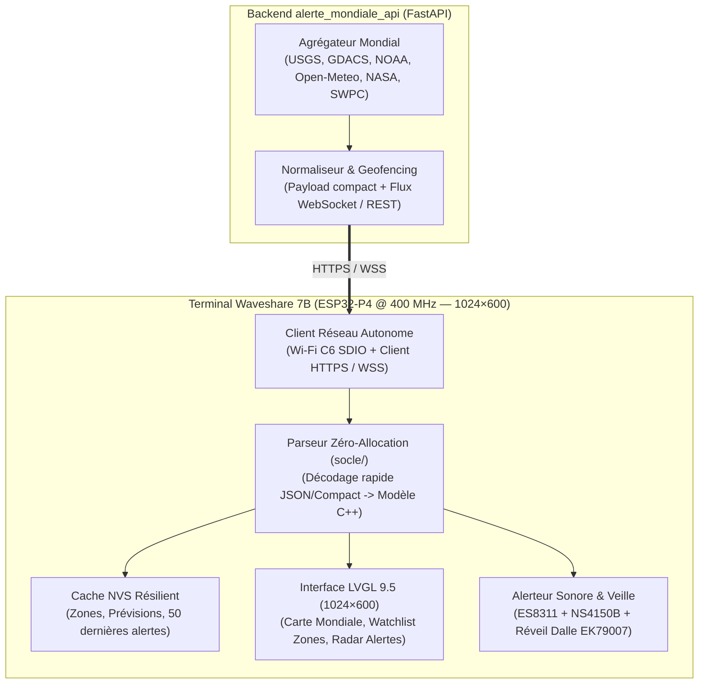

# Plan de Développement — Vigie Mondiale 7B (`alerte_mondiale_7b`)

`maj: 2026-10-18` · Architecture modulaire C++ / LVGL 9.5 sur Waveshare 7B (1024×600).

---

## 1. Architecture Logicielle Cible

---

## 2. Découpage en Lots (Feuille de Route)

### Lot 1 — Purge Domotique & Socle Matériel Autonome Multi-Écrans (`waveshare-7b` & `tab5`) *(Terminé)*
- Extraction et adaptation des briques matérielles validées pour **Waveshare 7B (`1024×600`)** et **M5Stack Tab5 V2 (`1280×720`)** (`carte-waveshare-7b.yaml`, `carte-tab5.yaml`, `tab5-hardware.yaml`, `geometrie-waveshare-7b.yaml`, `geometrie-tab5.yaml`).
- Suppression de tous les appels à Home Assistant (`homeassistant.*`, services HA domotiques, jeux, volets, lumières, froid, suivi, caméras).
- Création du point d'entrée autonome `vigie-mondiale-7b.yaml` multi-cibles (`vigie_carte: waveshare-7b` ou `tab5`) et du paquet GPS `firmware/paquets/vigie-gps-nmea.yaml`.

### Lot 2 — Modèle de Données Mondial, Marine & Parseur GPS NMEA (`socle/`) *(Terminé)*
- Implémentation de `firmware/socle/vigie_modele_mondial.h` et `vigie_modele_mondial.cpp` (100 % C++ pur sans allocation dynamique) :
  - `VigieGpsFix` : décodage NMEA 0183 temps réel (`$GxGGA`, `$GxRMC`, checksum XOR `*HH`), coordonnées nautiques DMS/DMM (`48°51.39'N 002°21.13'E`), SOG (nœuds et km/h), COG (°), HDOP, satellites, altitude MSL.
  - `VigieZoneMeteo`, `VigiePluieNowcast` (radar 60 min au pas de 5 min) et `VigieEtatMarin` (houle primaire/secondaire, Douglas, marées, courants, SST).
  - `VigieAlerteCatastrophe` : 12 catégories de risques mondiaux/marins, tri par criticité et proximité, recalcul temps réel des distances Haversine, azimuts et points cardinaux à 16 secteurs dès que le bateau/véhicule se déplace.
- Sauvegarde et relecture instantanée en NVS au boot.

### Lot 3 — Connecteur Réseau Direct (`ecran/vigie_client_api.h/.cpp`)
- Client HTTP/REST + flux temps réel (SSE ou WebSocket) natif ESP-IDF vers `alerte_mondiale_api`.
- Gestion automatique de la reconnexion, backoff exponentiel, indicateur de fraîcheur des données (« Live · il y a 12 s » / « Hors-ligne · Cache NVS »).

### Lot 4 — IHM Principale « Centre de Situation 1024×600 »
- **Bandeau supérieur** : Horloge UTC + Heure locale de la zone active, statut connexion Live, compteur d'alertes actives par couleur (Rouge / Orange / Jaune), indice géomagnétique Kp, bouton Paramètres/Langue.
- **Zone Centrale / Carte & Radar d'Alertes** :
  - Carte du monde vectorielle / matricielle sombre avec marqueurs lumineux temps réel des catastrophes actives (cercles concentriques selon la magnitude/sévérité) et position des zones surveillées.
  - Liste déroulante temps réel (Ticker) des dernières alertes sismiques, volcaniques, cycloniques et tsunamis.
- **Bandeau / Rouleau des Zones Mondiales** :
  - Navigation fluide par swipe entre les zones surveillées (ex. Paris, Tokyo, New York, Reykjavik, Singapour...) avec météo détaillée, radar de pluie à 1 h, vent, pression et prévisions 10 jours.

### Lot 5 — Popups Spécialisés & Mode Urgence (DEFCON)
- **Popup Détail Catastrophe** : Fiche complète d'un séisme / volcan / cyclone / tsunami (coordonnées, profondeur, source USGS/GDACS/NOAA, historique des répliques).
- **Popup Météo Mondiale Multi-Zones** : Courbes comparatives et détails horaires.
- **Écran d'Alerte Rouge Prioritaire** : Réveil forcé de l'écran + alerte sonore ES8311 + acquittement tactile.

### Lot 6 — Rendu Hors-Tablette (PC Host 1024×600) & Outillage Pro
- Adaptation du moteur de rendu natif PC (`vigie-rendu-host.yaml`) pour générer et vérifier visuellement tous les écrans 1024×600 avec des scénarios de catastrophes simulés (Séisme M7.8 Japon, Alerte Tsunami Pacifique, Ouragan Cat. 5 Atlantique, Éruption Islande).
- Portail de configuration des zones surveillées (Watchlist) et clés API.
