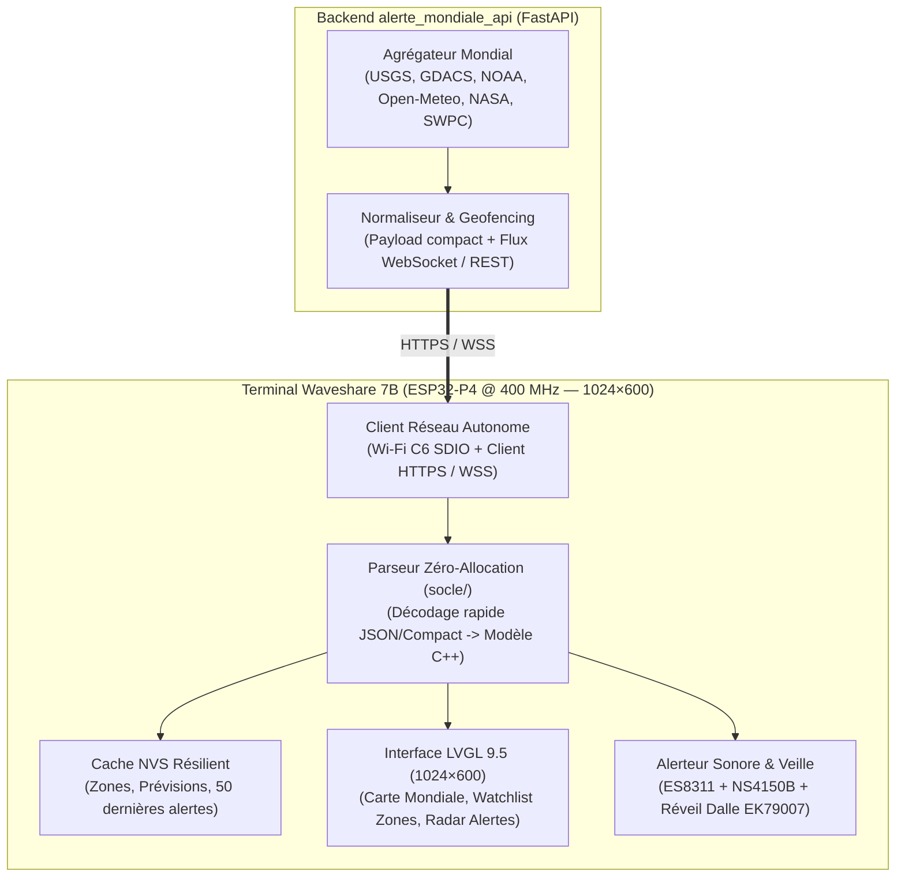

# Plan de Développement — Vigie Mondiale 7B (`alerte_mondiale_7b`)

`maj: 2026-10-18` · Architecture modulaire C++ / LVGL 9.5 sur Waveshare 7B (1024×600).

---

## 1. Architecture Logicielle Cible

---

## 2. Découpage en Lots (Feuille de Route)

### Lot 1 — Purge Domotique & Socle Matériel Autonome Multi-Écrans (`waveshare-7b` & `tab5`) *(Terminé)*
- Extraction et adaptation des briques matérielles validées pour **Waveshare 7B (`1024×600`)** et **M5Stack Tab5 V2 (`1280×720`)** (`carte-waveshare-7b.yaml`, `carte-tab5.yaml`, `tab5-hardware.yaml`, `geometrie-waveshare-7b.yaml`, `geometrie-tab5.yaml`).
- Suppression de tous les appels à Home Assistant (`homeassistant.*`, services HA domotiques, jeux, volets, lumières, froid, suivi, caméras).
- Création du point d'entrée autonome `vigie-mondiale-7b.yaml` multi-cibles (`vigie_carte: waveshare-7b` ou `tab5`) et du paquet GPS `firmware/paquets/vigie-gps-nmea.yaml`.

### Lot 2 — Modèle de Données Mondial, Marine, Parseur GPS NMEA & Persistance NVS (`socle/`) *(Terminé)*
- Implémentation de `firmware/socle/vigie_modele_mondial.h` et `vigie_modele_mondial.cpp` (100 % C++ pur sans allocation dynamique) :
  - `VigieGpsFix` : décodage NMEA 0183 temps réel (`$GxGGA`, `$GxRMC`, checksum XOR `*HH`), coordonnées nautiques DMS/DMM (`48°51.39'N 002°21.13'E`), SOG (nœuds et km/h), COG (°), HDOP, satellites, altitude MSL.
  - `VigieZoneMeteo`, `VigiePluieNowcast` (radar 60 min au pas de 15 min et 5 min) et `VigieEtatMarin` (vagues, période, houle, courants).
  - `VigieAlerteCatastrophe` : tri par criticité et proximité, recalcul temps réel des distances Haversine, azimuts, points cardinaux à 16 secteurs et ETA Tsunami.
  - Décodeur de trame API zéro-allocation (`vigie_decoder_trame_api`) avec vérification d'intégrité de bout en bout `END|<CRC32_HEX8>` (`vigie_verifier_crc_trame_api`) et persistance binaire NVS signée CRC32 (`vigie_preparer_bloc_nvs` / `vigie_restaurer_bloc_nvs`).

### Lot 3 — Connecteur Réseau Direct (`ecran/vigie_client_api.h/.cpp` & `paquets/vigie-client-api.yaml`) *(Terminé)*
- Client HTTP/REST autonome vers `alerte_mondiale_api` (`/v1/embedded/frame?device_type=...&lat=...&lon=...&marine=1`).
- Indicateur de fraîcheur des données (`LIVE · il y a Xs` / `HORS-LIGNE · Cache NVS`) et déclenchement d'urgence (`vigie_evaluer_declenchement_alerte` + anti-répétition `vigie_acquitter_alerte`).

### Lot 4 — IHM Principale « Centre de Situation » & Navigation Inter-Zones Multi-Écrans (`1024×600` & `1280×720`) *(Terminé)*
- **Bandeau supérieur** : Horloge UTC + Heure locale, statut Live, coordonnées GPS nautiques, compteurs d'alertes Rouge/Orange/Jaune, indice géomagnétique Kp.
- **Zone Centrale / Carte & Radar d'Alertes** : Projection cartographique équirectangulaire au pixel (`vigie_projeter_coord_carte`) avec ondes concentriques des catastrophes actives et marqueur du bateau GPS.
- **Navigation des Zones en Rouleau (`vigie_ihm_controleur.h/.cpp`)** : `vigie_zone_suivante`, `vigie_zone_precedente` et `vigie_selectionner_zone_gps` avec recalcul immédiat des distances et relèvements.

### Lot 5 — Popups Spécialisés, Mode Urgence (DEFCON) & Séquenceur Audio RTTTL (`ecran/vigie_ihm_controleur.h/.cpp` & `paquets/vigie-ihm-alertes.yaml`) *(Terminé)*
- **Fiche Détail Catastrophe (`VigieFicheDetailAlerte`)** : `vigie_preparer_fiche_detail_alerte` formatant sans allocation dynamique le titre, les sources confirmantes, les coordonnées DMS & nautiques, la métrique principale, la distance en `km` et `NM`, le relèvement `Cap °` + cardinal et le compte à rebours `ETA ~XX min (Onde Tsunami)`.
- **Profils Sonores d'Alerte Calibrés (`vigie_profil_sonore_pour_alerte`)** : mélodies RTTTL distinctes par catégorie/sévérité (Sirène Tsunami tri-ton, Alerte Sismique rapide, Alerte Ouragan/Grain marin, Alerte Volcan/Météo spatiale) avec volume strictement plafonné à `<= 75 %` (`0 dB` sans saturation sur l'`ES8311` de la Waveshare 7B).

### Lot 6 — Rendu Hors-Tablette Haute Fidélité (`tools/generer_rendu_ihm.py`) *(Terminé)*
- Génération automatique des aperçus SVG et PNG pixel-perfect dans `docs/rendus/` pour **Waveshare 7B (`1024×600`)** et **M5Stack Tab5 V2 (`1280×720`)** : écran principal « Centre de Situation » ET **Popup d'Urgence Critique Tsunami / Séisme (DEFCON ROUGE)**.

